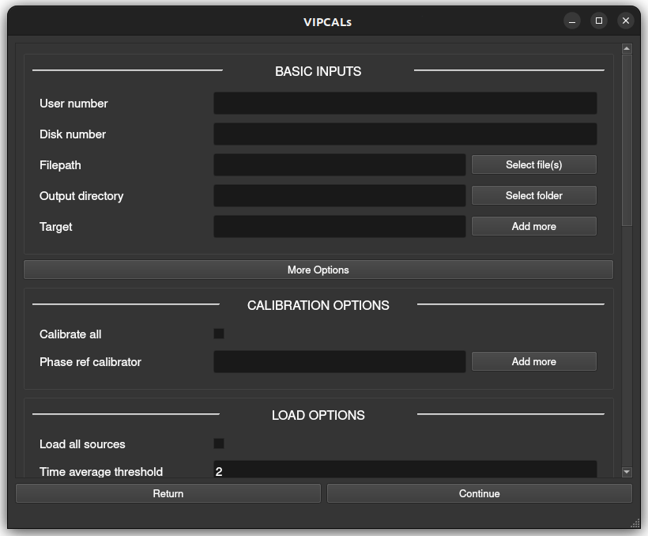
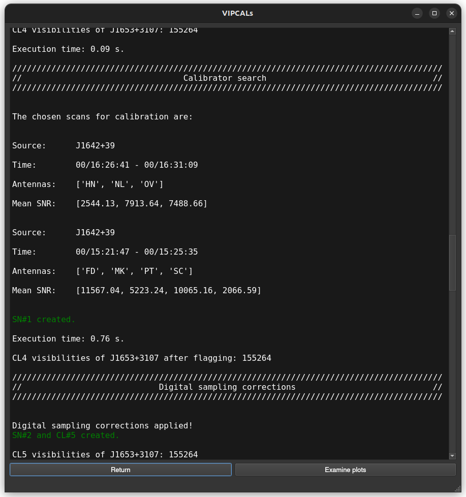
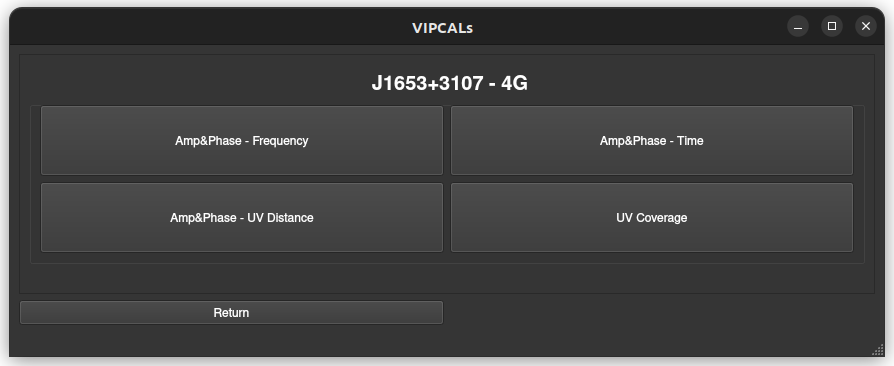
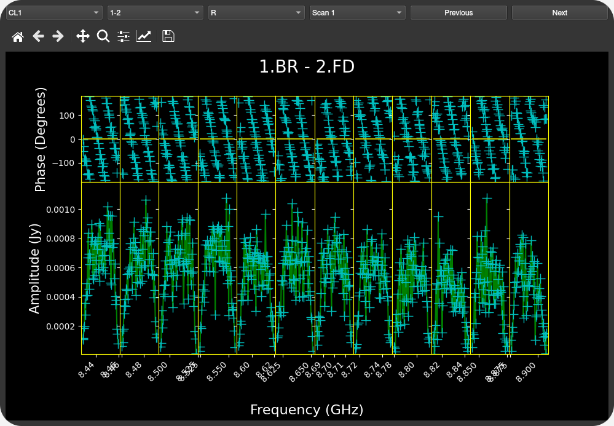
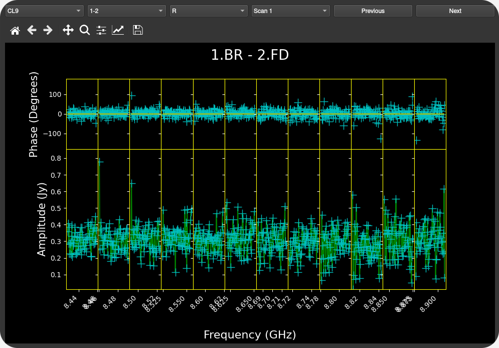

Usage
=====

Upon opening the pipeline, you will be presented with two modes:

Manual Input
~~~~~~~~~~~~

.. raw:: html

     
   
This mode allows calibration of a single observation (which may include multiple files) and lets you inspect the results via interactive plots. Below is a description of the different parameters that can be used, both compulsory and optional.

**Minimum Required Inputs**

- *User number*: AIPS user number *(manual installation only)*
- *Disk number*: AIPS disk number *(manual installation only)*
- *Filepath*: file(s) to calibrate
- *Output directory*: directory for output products
- *Target*: name(s) of science target(s) to calibrate

**Additional Options**

- **Calibration Options**

  - *Calibrate all*: calibrate all sources (default: only science target(s))
  - *Phase ref calibrator*: define specific source(s) to use as phase reference calibrator(s)

- **Loading Options**

  - *Load all sources*: load all sources (default: only science target(s) + 3 tentative calibrators)
  - *Load amp. calibration tables*: load external tables with system temperatures and gain curves in AIPS ANTAB format.
  - *Load flag tables*: load an external flag file in AIPS UVFLG format. Its flags are added to the initial flag table (FG1), together with any flags already in the data or retrieved online. See :ref:`external-flags` for the format and for how IFs are numbered.
  - *Time average threshold*: minimum integration time in seconds. If the data have a shorter time sampling, it will be averaged in time up to this value (0 to disable)
  - *Freq. average threshold*: minimum channel width in kHz. If the data have narrower channels, they will be averaged in frequency up to this value (0 to disable)
  - *Phase center shift*: give coordinates to shift the phase center of each target if more accurate positions are available.  
    Format: ``"175.858625 18.577322"`` or ``"11h43m26.07s +18d34m38.36s"``

- **Reference Antenna Options**

  - *Reference antenna*: fixed reference antenna (e.g., `"LA"`)
  - *Priority antennas*: list of preferred antennas to be used as reference antenna (e.g., `"LA"`, `"FD"`, `"EF"`)
  - *Search central antennas*: prioritize central array antennas (VLBA only)
  - *Maximum scans*: maximum number of scans per source to use in the automatic reference antenna search *(default: 10)*

- **Fringe Fit Options**

  - *Signal-to-noise threshold*: minimum SNR accepted during the FFT step of the fringe fit on the science target
  - *Fixed solution interval*: fixed solution interval in minutes
  - *Minimum solution interval*: minimum allowed interval (in minutes) when searching for the optimal solution interval
  - *Maximum solution interval*: maximum allowed interval (in minutes) when searching for the optimal solution interval

- **Export Options**

  - *Channel out*:

    - `SINGLE`: before exporting, average in frequency to 1 channel per IF
    - `MULTI`: export all channels

  - *Edge flagging*: channels to discard at the beginning and end of each IF in the target fringe fit, the exported data and the calibrated plots:

    - If < 0.5: discard that fraction of the channels at each edge of the IF
    - If ≥ 1 and integer: discard that number of channels at each edge of the IF, counted after the frequency average

- **Plotting Options**

  - *Interactive plots*: enable GUI plots (manual mode only)
  
  .. warning::
     Generating these plots can consume lots of time and disk storage. It is advised to disable them for large datasets.  
     Static `.pdf` plots are always saved in the output directory.
  
  
Pipeline log
------------
  
During the pipeline run, real time information is displayed in the GUI. All this information will be also available as a text file after the calibration.

   
.. raw:: html

     

Interactive plots
-----------------

After a successful pipeline run, the user is given the option to display some diagnostic plots. The available plots are 

- Amplitude and phase vs Frequency
- Calibrated amplitude and phase vs Time
- Calibrated amplitude and phase vs uv-distance
- uv coverage

These plots are grouped by source and frequency band. 

   
.. raw:: html

     
   

   
.. raw:: html

     
   

   
.. raw:: html

     
   
   
.. warning::
     The interactive plots are under active development and still present some small bugs, especially when there is no data available for multiple baselines.

----

JSON Input
~~~~~~~~~~

For batch processing, inputs can be supplied via a JSON file. All parameters mirror the manual input described above. As before, when running in Docker, both `userno` and `disk` should be omitted.

A JSON file can contain several calibration blocks, which are run one after the other. Each block is a JSON object, and blocks are separated by **one empty line**. For this reason, a block must not contain empty lines itself.

JSON files can be run from the GUI (*JSON Input* in the main menu) or from the command line, see :ref:`cli-usage`.

**Minimum JSON Fields**

+--------------------+----------------+
| Key                | Type           |
+====================+================+
| userno             | int            |
+--------------------+----------------+
| disk               | int            |
+--------------------+----------------+
| paths              | list of str    |
+--------------------+----------------+
| targets            | list of str    |
+--------------------+----------------+
| output_directory   | str            |
+--------------------+----------------+

**Optional JSON Fields**

+---------------------------+----------------------------+
| Key                       | Type                       |
+===========================+============================+
| calib_all                 | bool                       |
+---------------------------+----------------------------+
| phase_ref                 | list of str                |
+---------------------------+----------------------------+
| load_all                  | bool                       |
+---------------------------+----------------------------+
| load_tables               | str                        |
+---------------------------+----------------------------+
| load_flags                | str                        |
+---------------------------+----------------------------+
| time_aver                 | float                      |
+---------------------------+----------------------------+
| freq_aver                 | float                      |
+---------------------------+----------------------------+
| shifts                    | list of str                |
+---------------------------+----------------------------+
| refant                    | str                        |
+---------------------------+----------------------------+
| refant_list               | list of str                |
+---------------------------+----------------------------+
| search_central            | bool                       |
+---------------------------+----------------------------+
| max_scan_refant_search    | float                      |
+---------------------------+----------------------------+
| fringe_snr                | float                      |
+---------------------------+----------------------------+
| solint                    | float                      |
+---------------------------+----------------------------+
| min_solint                | float                      |
+---------------------------+----------------------------+
| max_solint                | float                      |
+---------------------------+----------------------------+
| channel_out               | str ("SINGLE" or "MULTI")  |
+---------------------------+----------------------------+
| flag_edge                 | float                      |
+---------------------------+----------------------------+
| interactive               | bool                       |
+---------------------------+----------------------------+

**Examples**

Below you can find some examples of typical JSON files that can be given to VIPCALs

.. code-block:: json

   {
     "userno": 4,
     "disk": 9,
     "paths": [
       "/data/pipeline_test_sample/diego/BR235/BR235M/VLBA_BR235M_br235m_BIN0_SRC0_0_210726T164755.idifits"
     ],
     "targets": ["1611+179", "1428+254", "1443+188"],
     "output_directory": "/home/dalvarez/vipcals/vipcals/101_200",
     "refant_list": ["LA", "FD"]
   }

   {
     "userno": 4,
     "disk": 9,
     "paths": [
       "/data/pipeline_test_sample/felix/BR235/BR235O/VLBA_BR235O_br235o_BIN0_SRC0_0_210217T213934.idifits"
     ],
     "targets": ["0912+237"],
     "output_directory": "/home/dalvarez/vipcals/vipcals/101_200",
     "shifts": ["138.72500917 23.53151889"]
   }

Note that sources and coordinates in the *"phase_ref"* and *"shifts"* fields have to be given in the same order as the sources in the *"targets"* field. If there is any source where those options should not apply, then it can be skipped by giving a null value:

.. code-block:: json

   {
     "userno": 4,
     "disk": 9,
     "paths": [
       "/data/pipeline_test_sample/felix/BR235/BR235O/VLBA_BR235O_br235o_BIN0_SRC0_0_210217T213934.idifits"
     ],
     "targets": ["0737+171", "0912+237"],
     "phase_ref": ["0740+155", null],
     "output_directory": "/home/dalvarez/vipcals/vipcals/101_200",
     "shifts": [null, "138.72500917 23.53151889"]
   }
   
----

.. _external-flags:

External flag files
~~~~~~~~~~~~~~~~~~~

With *Load flag tables* in the GUI, or ``load_flags`` in a JSON file, you can give a text file with flags in the AIPS UVFLG ``INTEXT`` format (see ``explain uvflg`` in AIPS). The file is applied with UVFLG right after the data are loaded, before any averaging, and its flags are **added** to the initial flag table (FG1). Flags already present in the data, or retrieved online, are kept. A copy of the file is saved in the */TABLES/* folder of each target.

Each entry ends with ``/`` and anything after ``!`` is a comment. For example:

.. code-block:: text

   ! Flag BR and HN for the whole observation
   opcode='FLAG'
   ant_name='BR' reason='BAD RECEIVER' /
   ant_name='HN' reason='BAD RECEIVER' /
   ! Flag KP between 09:00 and 09:30 on day 73 of the year
   ant_name='KP' timerang=73,9,0,0,73,9,30,0 reason='SNOW' /
   ! Flag a frequency range with RFI, in MHz
   bfreq=2290 efreq=2300 reason='RFI' /

Some details to take into account:

- **Antennas**: use ``ant_name`` rather than ``antennas``. Antenna numbers can differ between files and after concatenating several files, while names do not.
- **Times**: when an entry uses ``ant_name``, the day in ``timerang`` is the **day of the year** of the observation (e.g. 73 for 13 March), not the day number relative to the start of the observation. An entry without ``timerang`` applies to the whole observation.
- **Channels**: ``bchan``/``echan`` refer to the channels of the original data, since the flags are applied before the frequency average.

.. warning::
   **IF numbers refer to the frequency band as loaded in AIPS, not to the original file.**

   Before loading, the pipeline splits the data into frequency bands, and each band is calibrated separately. IFs are sorted by frequency and a new band starts wherever two of them are more than 500 MHz apart, so the IFs of a band do not need to be consecutive in the file. The IFs of each band are then numbered from 1, keeping their order in the file. For example, for a file with IFs at

   ===========  =====  =====  =====  =====  =====  =====
   File IF        1      2      3      4      5      6
   Frequency    2.2 G  2.3 G  8.4 G  8.5 G  2.4 G  8.6 G
   ===========  =====  =====  =====  =====  =====  =====

   the S band is loaded with file IFs 1, 2, 5 as AIPS IFs 1, 2, 3, and the X band with file IFs 3, 4, 6 as AIPS IFs 1, 2, 3. The IFs loaded from the original file are listed in the *_VIPCALslog.txt* file of each band.

   The same flag file is applied to every band. An entry with ``bif=2 eif=2`` therefore flags the second IF of **each** band, and an entry with ``bif`` larger than the number of IFs of a band makes UVFLG fail. If your file contains more than one band, use ``bfreq``/``efreq`` instead of ``bif``/``eif``: frequency ranges are converted to the right IFs and channels of each band, and ranges outside a band are ignored.

----

.. _cli-usage:

Command line
~~~~~~~~~~~~

The pipeline can also run without the GUI, which is useful on remote servers without a display or for long batch runs. In this mode it reads the same JSON files described above.

**Manual installation**

Activate the environment, make sure AIPS is available in the shell, and pass a JSON file to the pipeline with ``ParselTongue``:

.. code-block:: bash

   conda activate vipcalsenv
   VIPCALS_DIR=$(python -c "import os, vipcals; print(os.path.dirname(vipcals.__file__))")
   ParselTongue $VIPCALS_DIR/__main__.py input.json

The same information shown in the GUI is printed in the terminal, and the log files are written to the output directory as usual. To keep the pipeline running after closing the terminal, run it in the background and save the terminal output to a file:

.. code-block:: bash

   nohup ParselTongue $VIPCALS_DIR/__main__.py input.json > vipcals_run.log 2>&1 &

or start it inside a ``screen`` or ``tmux`` session.

.. note::
   Interactive plots can only be displayed in the GUI, so leave ``interactive`` at its default (``false``) when running from the command line. The static plots in the */PLOTS/* folder are always produced.

Outputs
~~~~~~~~

Below is a representative structure of the output directory produced by the pipeline:

.. code-block:: text

    EA075/
    ├── J1159+2914_EA075_22G_2024-03-13/
    │   ├── PLOTS/
    │   │   ├ J1159+2914_EA075_22G_2024-03-13_CL1_POSSM.pdf
    │   │   ├ J1159+2914_EA075_22G_2024-03-13_CL9_POSSM.pdf
    │   │   ├ J1159+2914_EA075_22G_2024-03-13_TSYS_TY1.pdf
    │   │   ├ J1159+2914_EA075_22G_2024-03-13_TSYS_TY2.pdf
    │   │   ├ J1159+2914_EA075_22G_2024-03-13_UVPLT.pdf
    │   │   ├ J1159+2914_EA075_22G_2024-03-13_VPLOT.pdf
    │   │   ├ J1159+2914_EA075_22G_2024-03-13_RADPLOT.pdf
    │   │   ├ J1159+2914_EA075_22G_2024-03-13_VISANT.pdf
    │   │
    │   ├── TABLES/
    │   │   ├ flags.vlba
    │   │   ├ gaincurves.vlba
    │   │   ├ tsys.vlba
    │   │   ├ my_flags.uvflg
    │   │   ├ J1159+2914_EA075_22G_2024-03-13.caltab.uvfits
    │   │
    │   ├ J1159+2914_EA075_22G_2024-03-13.stats.csv
    │   ├ J1159+2914_EA075_22G_2024-03-13.uvfits
    │   ├ J1159+2914_EA075_22G_2024-03-13_AIPSlog.txt
    │   ├ J1159+2914_EA075_22G_2024-03-13_scansum.txt
    │   ├ J1159+2914_EA075_22G_2024-03-13_VIPCALslog.txt
    │
    │
    ├── J1143+1834_EA075_22G_2024-03-13/
    │   ├── 
    :   :
    :   :

For each calibrated source, there is a directory that contains:

- *\*.stats.csv*: metadata on the observation and the calibration process in csv format
- *\*.uvfits*: calibrated fits file
- *\*_AIPSlog.txt*: output produced by AIPS after each step
- *\*_scansum.txt*: summary of the observation including scan list and frequency setup
- *\*_VIPCALslog.txt*: human-readable summary of the calibration produced by VIPCALs

The pipeline also generates the following plots inside the */PLOTS/* folder. Plots produced by AIPS are converted from PostScript to PDF:

- *\*_CL1_POSSM.pdf*: uncalibrated visibilities vs frequency
- *\*_CL9_POSSM.pdf*: calibrated visibilities vs frequency
- *\*\_TSYS\_TY1.pdf*: original antenna system temperatures vs time
- *\*\_TSYS\_TY2.pdf*: smoothed antenna system temperatures vs time
- *\*\_UVPLT.pdf*: UV coverage of the calibrated observation
- *\*\_VPLOT.pdf*: calibrated visibilities vs time
- *\*\_RADPLOT.pdf*: calibrated visibilities vs uv-distance
- *\*\_VISANT.pdf*: number of visibilities per antenna across the different calibration tables

and the following tables in the */TABLES/* folder:

- *flags.vlba*: initial flags of the observation (if not included in the file)
- *gaincurves.vlba*: gain curves of each antenna (if not included in the file)
- *tsys.vlba*: antenna system temperatures (if not included in the file)
- a copy of the external flag file, with its original name (if one was given)
- *\*.caltab.uvfits*: AIPS tables used during the calibration